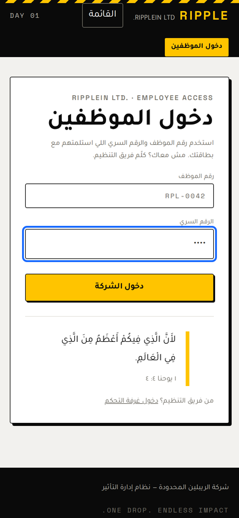
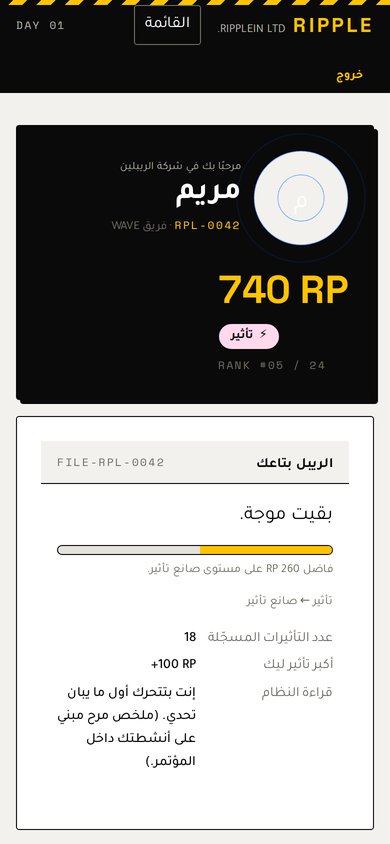
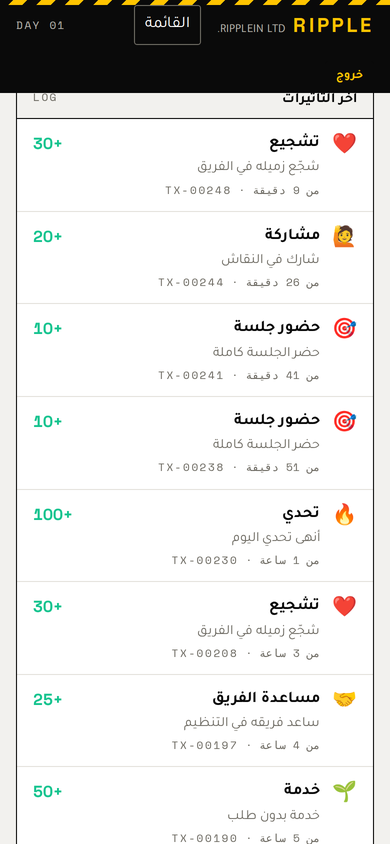
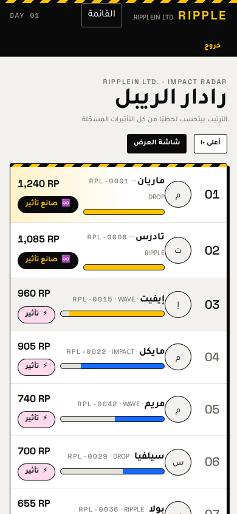
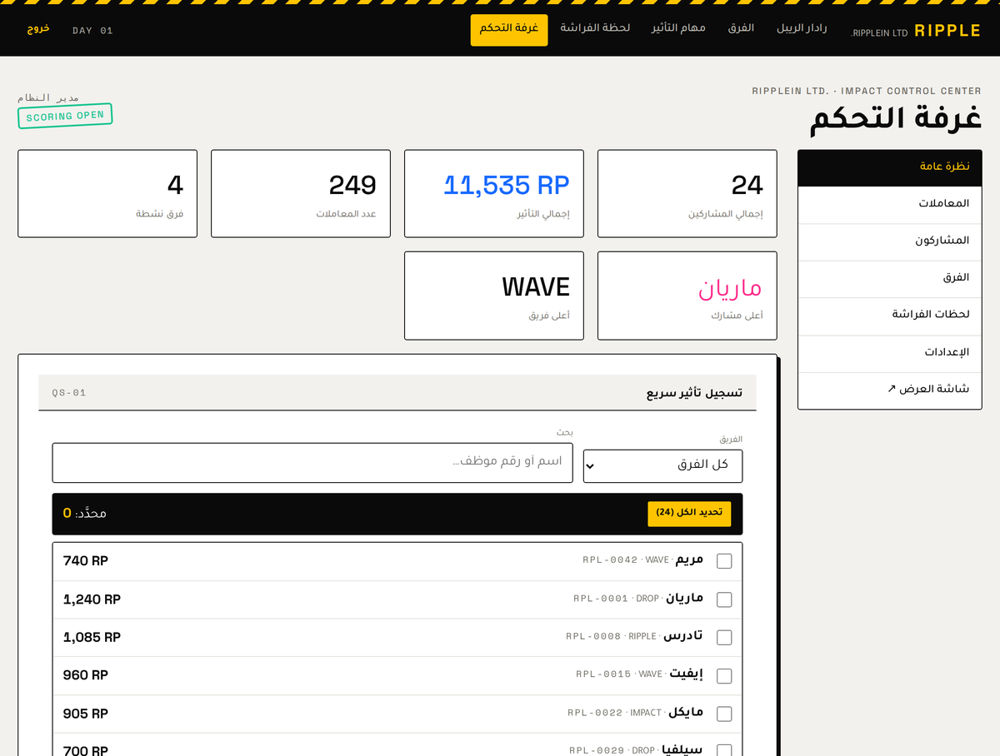
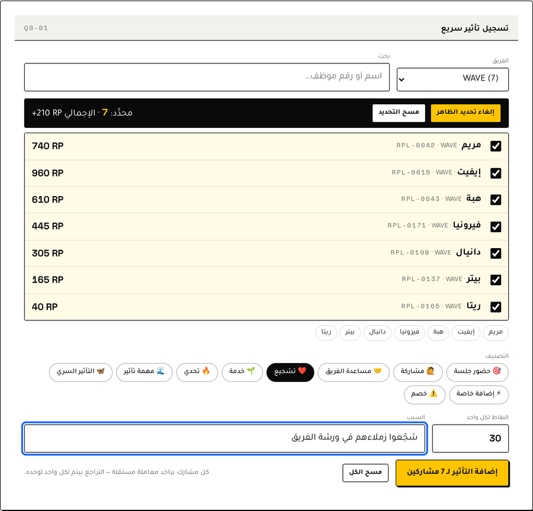
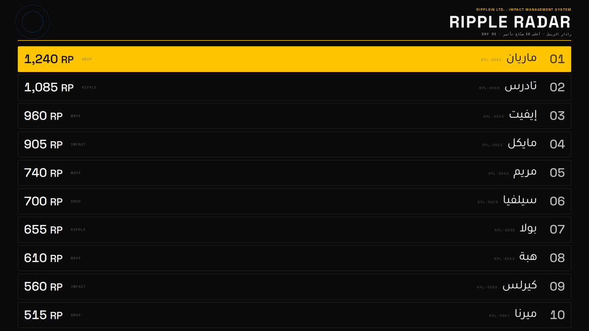
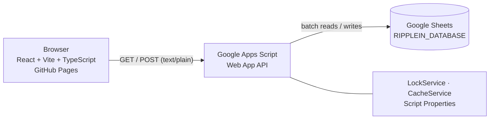

<div align="center">

# RIPPLEIN LTD. — Impact Management System

**ONE DROP. ENDLESS IMPACT.** · قطرة واحدة… تأثير بلا حدود

A live-event gamification platform built for **RIPPLE 2026**, a youth conference.
Participants join a fictional company, earn *Ripple Points*, level up, and climb a live ranking.
Organizers run everything from a control room. Arabic RTL-first, serverless, zero cost.

[**Live demo**](https://bishoybotros.github.io/ripplein-dashboard/) ·
[Setup guide](docs/SETUP.md) ·
[API](docs/API.md) ·
[دليل التشغيل بالعربي](GUIDE_AR.md)


</div>

> The landing page is public. Participant and admin areas require credentials issued by the organizers.
> All screenshots below use demo data with fictional first names.

---

## The idea

Most conference scoreboards are a table. This one is a world.

Every participant joins **RIPPLEIN LTD.**, a fictional company that measures one thing: **impact**.
They get an Employee ID, complete missions, collect **RP (Ripple Points)**, unlock badges, and move through five levels:

`Drop` → `Ripple` → `Wave` → `Impact` → `Ripple Maker`

Level thresholds are configurable from the Settings sheet, not hard-coded.

## Screenshots

### Participant

<p align="center">
  
  
  
  
</p>

### Organizers

<p align="center">
  
  
</p>

### Event screen

<p align="center">
  
</p>

## Features

**Participants**
- Profile with points, level, rank, and progress to the next level
- Impact history for every transaction
- Ten badges derived from activity, unlocked automatically
- Live ranking radar with team and level on every row
- Butterfly Moment: a private reflection, visible only to the participant and organizers

**Organizers**
- Control room with stats, search, filters (participant, team, category, date), and CSV export
- **Quick Score** with team filter and multi-select: award one impact to a whole team in a single operation
- Penalties and **undo** that never delete a record
- Participant and team management, plus a settings page for day, levels, and scoring on/off
- Every admin action is written to an activity log
- Fullscreen **Event Screen** that refreshes itself, with no controls on it

**Platform**
- Ranks, totals, and levels are computed from the transaction log, never typed by hand
- Participants cannot change points, rank, team, or level, and cannot open another participant's profile
- Arabic RTL-first UI, bilingual system labels, mobile first
- Accessibility: semantic HTML, keyboard navigation, visible focus, skip link, `prefers-reduced-motion`

## Architecture



| Decision | Why |
|---|---|
| **Transactions are the source of truth** | `totalPoints` in the sheet is only a cached value. Every total, rank, and level is recomputed from valid transactions. |
| **Undo = `reversed: true`** | The row stays, with `reversedAt` and `reversedBy`, so the audit trail is complete. |
| **Server-side authorization** | The frontend is public. Every write checks a session token and role inside Apps Script. |
| **Session tokens in `CacheService`** | Six-hour expiry, renewed on use. No password is stored in the browser. |
| **`LockService` around writes** | Two admins scoring at the same moment cannot collide. |
| **Bulk endpoint** | One lock and one sheet write for up to 200 participants, still one independent transaction per person. |
| **POST as `text/plain`** | Keeps it a "simple" CORS request. Apps Script does not answer preflight (`OPTIONS`). |
| **`HashRouter`** | GitHub Pages does not rewrite routes, so hash routes work with no extra setup. |
| **Polling, not WebSockets** | Google Sheets is not a realtime database. Polling is configurable and pauses when the tab is hidden. |

## Tech stack

| Layer | Choice |
|---|---|
| Frontend | React 18, TypeScript, Vite, React Router (hash) |
| Styling | Plain CSS with design tokens. No UI framework. |
| Backend | Google Apps Script Web App (`doGet` / `doPost`) |
| Database | Google Sheets (8 tabs) |
| Hosting | GitHub Pages, deployed by GitHub Actions on every push to `main` |
| Fonts | Tajawal, Space Grotesk, Space Mono |

The production bundle is about 73 KB of gzipped JavaScript.

## Data model

`Participants` · `Teams` · `Transactions` · `Categories` · `Admins` · `Settings` · `ActivityLog` · `ButterflyMoments`

Full column definitions are in [docs/SHEETS_SCHEMA.md](docs/SHEETS_SCHEMA.md).

## Quick start

**1. Backend (Google)**
1. Create a Google Sheet named `RIPPLEIN_DATABASE`.
2. **Extensions → Apps Script**, then paste the four files from [`apps-script/`](apps-script/).
3. Run `installDatabase()` once to create the tabs, categories, teams, and settings.
4. **Project Settings → Script Properties**: add `ADMIN_SECRET`.
5. **Deploy → New deployment → Web app**, Execute as **Me**, access **Anyone**. Copy the `/exec` URL.

**2. Frontend**
```bash
git clone https://github.com/bishoybotros/ripplein-dashboard.git
cd ripplein-dashboard
npm install
cp .env.example .env      # set VITE_API_URL to your /exec URL
npm run dev
```

**3. Deploy**
- **Settings → Pages → Source: GitHub Actions**
- **Settings → Secrets and variables → Actions → Variables**: add `VITE_API_URL`
- Push to `main`. The workflow builds and publishes the site.

Detailed steps, permissions, and troubleshooting: [docs/SETUP.md](docs/SETUP.md) and [docs/GUIDE_AR.md](docs/GUIDE_AR.md).

Optional: run `seedSampleData()` to try the system with demo participants.

## API

One endpoint, JSON in and out. Reads use `GET`, writes use `POST`.

| Access | Actions |
|---|---|
| Public | `getBootstrap`, `getLeaderboard`, `getTeams`, `getTeam`, `getStats`, `getCategories`, `getSettings` |
| Participant | `login`, `logout`, `getParticipant`, `getTransactions`, `getMyButterfly`, `submitButterflyMoment` |
| Admin | `adminLogin`, `addTransaction`, `addTransactionBulk`, `reverseTransaction`, `createParticipant`, `updateParticipant`, `createTeam`, `updateSettings`, `recalculate`, `adminGet*` |

Responses look like `{ "ok": true, "data": … }` or `{ "ok": false, "error": { "code", "message" } }`.
Reference: [docs/API.md](docs/API.md).

## Testing

```bash
npm run test:api     # 66 backend tests
npm run typecheck
npm run build
```

The backend tests run the real `Code.gs` and `Data.gs` against an in-memory simulation of Sheets, Cache, Lock, and Properties, so no Google account is needed.
They cover authorization, input validation, scoring, penalties, undo, bulk scoring, level-ups, team totals, sessions, and settings.

A manual checklist for event day is in [docs/TESTING.md](docs/TESTING.md).

## Security

- No secrets in the frontend or the repository. `VITE_API_URL` is the only variable, and it is public.
- `ADMIN_SECRET` lives in Apps Script Script Properties.
- Participants see only their own data, even if the URL `id` is changed (covered by tests).
- Butterfly Moment answers are private by default and never exposed by a public endpoint.

Details and accepted trade-offs: [docs/SECURITY.md](docs/SECURITY.md).

## Known limitations

- Updates arrive by polling, so there is a short delay (default 8 seconds, configurable).
- Apps Script has daily quotas. For more than a few hundred participants, raise the refresh interval.
- Participant PINs are stored as text in a private sheet. This is a deliberate trade-off so organizers can help anyone who forgets theirs.
- Leaderboard data is public by design, because it is shown on the event screen.

## Project structure

```
ripplein-dashboard/
├── apps-script/        Config.gs · Data.gs · Code.gs · Setup.gs · tests/
├── docs/               SETUP · API · SECURITY · SHEETS_SCHEMA · TESTING · GUIDE_AR
├── src/
│   ├── components/     layout, UI kit, QuickScore, RankList, Canister …
│   ├── pages/          public pages and admin/
│   ├── services/       API client, session
│   ├── hooks/          usePolling
│   ├── utils/          levels, formatting, CSV
│   └── styles/         tokens.css, global.css
└── .github/workflows/  deploy.yml
```

## Design language

An industrial corporate world: hazard stripes, serial numbers, employee badges, system alerts, and an "Impact Canister" gauge.
Flat colors and hard shadows, with almost no gradients. Ripple animations appear only on meaningful events: a score is added, a level changes, a page loads.

Palette: `#FFC400` yellow · `#0A0A0A` black · `#FFFFFF` white · `#1769FF` blue · `#FF2B8A` pink.

RIPPLEIN LTD. is an original fictional universe. No assets or branding are borrowed from any other work.
